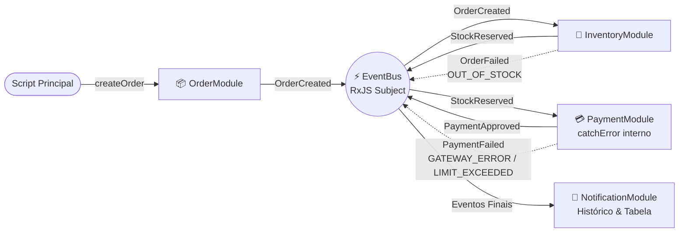

<div align="center">

# ⚡ Reactive Agent Harness

### Experimento A/B: Engenharia de Software Assistida por IA *Sem* vs. *Com* Governança

[](https://www.typescriptlang.org/)
[](https://rxjs.dev/)
[](https://biomejs.dev/)
[](https://vitest.dev/)
[](https://github.com/sverweij/dependency-cruiser)
[](#)

**Autores:** Ricardo Costa Filho & Davison Gabriel Monteiro de Farias

[O Problema](#-o-problema-e-o-que-é-um-harness) •
[Arquitetura](#-arquitetura-do-sistema) •
[Resultados](#-comparativo-de-resultados) •
[Estrutura](#-estrutura-do-repositório) •
[Como Executar](#-como-executar) •
[Material Complementar](#-material-complementar)

</div>

---

## 🎯 O Problema e o que é um "Harness"?

Modelos modernos de IA conseguem escrever código funcional em minutos. Porém, sem restrições técnicas automatizadas, eles frequentemente entregam **dívida técnica silenciosa**: arquivos mal organizados, falta de checagem estrita de tipos em build, alertas de estilo e ausência de proteção contra acoplamento futuro.

Um **Harness de Engenharia** é a camada de governança que cerca o agente — combinando regras explícitas (`AGENTS.md` e `.antigravity/rules.md`) com um ciclo de feedback determinístico (`npm run validate`). Em vez de depender apenas do prompt, o próprio agente audita e corrige seu código antes de concluir a tarefa.

> [!IMPORTANT]
> **Controle Científico do Experimento:** Ambas as implementações foram geradas no **Antigravity IDE**, usando o mesmo modelo (**`Gemini 3.8 Flash High`**), a mesma especificação ([`SPEC.md`](./SPEC.md)), exatamente o mesmo **Prompt Único** e **0 intervenções manuais** após o envio do comando.

---

## 🧩 Arquitetura do Sistema

O desafio proposto foi um **pipeline reativo de pedidos de e-commerce em memória** (TypeScript + RxJS) sob uma regra inegociável: **desacoplamento total**. Nenhum módulo pode importar outro diretamente — toda comunicação flui pelo `EventBus`.



| Componente | Responsabilidade |
| :--- | :--- |
| **`EventBus`** | Barramento central baseado em `Subject` do RxJS para publicação e assinatura tipada de eventos. |
| **`OrderModule`** | Porta de entrada dos pedidos; publica `OrderCreated`. |
| **`InventoryModule`** | Controla estoque em memória; emite `StockReserved` ou `OrderFailed` (`OUT_OF_STOCK`). |
| **`PaymentModule`** | Recusa valores `> 1000` (`LIMIT_EXCEEDED`), trata falhas de gateway (`GATEWAY_ERROR`) com `catchError` interno sem derrubar o stream e aprova com `PaymentApproved`. |
| **`NotificationModule`** | Registra o histórico auditável dos desfechos finais e exibe o relatório tabular. |

Todos os módulos implementam `dispose()` para encerramento limpo das assinaturas. O script `npm start` comprova **4 cenários sequenciais**:
1. ✅ **Pedido válido** → `PaymentApproved`
2. ❌ **Falta de estoque** → `OrderFailed (OUT_OF_STOCK)`
3. ⚠️ **Erro simulado no gateway** → `PaymentFailed (GATEWAY_ERROR)`
4. 🔄 **Novo pedido válido após o erro** → `PaymentApproved` *(prova que o stream permaneceu vivo)*

---

## 📊 Comparativo de Resultados

Após a geração, as ferramentas de auditoria do Harness foram aplicadas sobre **ambas** as bases de código:

| Critério / Métrica | 🔓 Sem Harness (`sem-harness/`) | 🛡️ Com Harness (`com-harness/`) |
| :--- | :--- | :--- |
| **Branch Original** | [`exp/sem-harness`](https://github.com/Userkhan444/reactive-agent-harness/tree/exp/sem-harness) *(Davisson)* | [`exp/com-harness`](https://github.com/Userkhan444/reactive-agent-harness/tree/exp/com-harness) *(Ricardo)* |
| **Intervenções Manuais** | `0` correções manuais | `0` correções manuais |
| **Comportamento da IA** | Implementação direta em 1 passagem | Plano de 8 etapas + auditoria completa |
| **Organização de Pastas** | ⚠️ Plana (`src/modules/*.module.ts`) | ✅ Isolada por domínio (`src/modules/<domínio>/`) |
| **Contratos Compartilhados** | `src/types/index.ts` e `src/bus/event-bus.ts` | `src/shared/events.ts` e `src/shared/event-bus.ts` |
| **Compilação Estrita (`tsc`)** | ❌ Ausente (apenas `tsx` em runtime) | ✅ `tsc --noEmit` ativo (**0 erros**) |
| **Análise Estática (Biome)** | ⚠️ **4 apontamentos** (3 warnings + 1 info) | ✅ **0 apontamentos** em 14 arquivos |
| **Grafo Arquitetural (`depcruise`)** | ❌ Ausente (sem barreira de acoplamento) | ✅ **0 violações** (13 módulos / 25 dependências) |
| **Suíte de Testes** | 1 arquivo (`node:test`) — **5 testes** | 2 arquivos (Vitest) — **8 testes** |
| **Execução (`npm start`)** | ✅ Funcional (`order-1` a `order-4` + `dispose()`) | ✅ Funcional (`ORD-001` a `ORD-004` + `dispose()`) |

<details>
<summary>🔍 <b>Clique para ver os detalhes técnicos da auditoria em cada execução</b></summary>

#### 🔓 Achados em `sem-harness/` (11 arquivos auditados)
* **Topologia plana:** Todos os módulos foram colocados diretamente na raiz de `src/modules/`, misturando domínios.
* **4 apontamentos do Biome:** 3 alertas `lint/style/useImportType` (importação de `Observable` sem a palavra-chave `type` em `event-bus.ts`, `inventory.module.ts` e `payment.module.ts`) e 1 sugestão `lint/style/useTemplate` (concatenação com `+` em `src/index.ts`).
* **Sem proteção em build:** O pacote `typescript` não foi instalado nas dependências e não havia regra impedindo importações diretas entre módulos.

#### 🛡️ Achados em `com-harness/` (14 arquivos auditados)
* **Isolamento modular:** Contratos e barramento centralizados em `src/shared/` e cada domínio em seu próprio diretório (`order/`, `inventory/`, `payment/`, `notification/`).
* **Validação determinística (`npm run validate`):** `tsc --noEmit` (0 erros), `biome lint` (0 alertas), `depcruise` (0 violações em 13 módulos e 25 dependências) e `vitest run` (8 testes em 2 suítes, incluindo testes unitários isolados do `EventBus`).

</details>

> [!TIP]
> **Conclusão Principal:** Mesmo com um modelo capaz de acertar a lógica funcional de primeira, a ausência de governança deixa o projeto vulnerável à dívida técnica silenciosa. O Harness converte regras de arquitetura em feedback executável, elevando a qualidade estrutural e a cobertura de testes com **zero esforço humano extra**.

---

## 📂 Estrutura do Repositório

```text
reactive-agent-harness/
├── com-harness/     # 🛡️ Grupo Experimental (exp/com-harness): isolamento por domínio + Harness completo
├── docs/            # 📄 Relatórios completos do experimento (PDFs)
├── sem-harness/     # 🔓 Grupo de Controle (exp/sem-harness): topologia plana + node:test
├── .gitignore       # Arquivos e pastas ignorados pelo Git
├── README.md        # Documentação principal e comparativo A/B
└── SPEC.md          # Especificação técnica e Prompt Único
```

---

## 🚀 Como Executar

### 1. Experimento Sem Harness
```bash
cd sem-harness
npm install
npm start
npm test
```

### 2. Experimento Com Harness
```bash
cd com-harness
npm install
npm run validate   
npm start
```

---

## 📚 Material Complementar

| Material | Descrição |
| :--- | :--- |
| [`SPEC.md`](./SPEC.md) | Especificação técnica do pipeline reativo e **Prompt Único** utilizado em ambas as execuções. |
| [`Guia Explicativo (PDF)`](./docs/Guia%20Explicativo%20%E2%80%94%20Experimento%20Reactive%20Agent%20Harness.pdf) | Visão geral didática sobre o conceito de Harness, a arquitetura do sistema e os resultados obtidos. |
| [`Relatório Técnico Comparativo (PDF)`](./docs/Relat%C3%B3rio%20T%C3%A9cnico%20Comparativo%20%E2%80%94%20Reactive%20Agent%20Harness.pdf) | Auditoria técnica detalhada com métricas, achados de linter, tipagem e grafo de dependências. |
| [`Branch exp/sem-harness`](https://github.com/Userkhan444/reactive-agent-harness/tree/exp/sem-harness) | Histórico original e isolado da execução sem governança *(Grupo de Controle)*. |
| [`Branch exp/com-harness`](https://github.com/Userkhan444/reactive-agent-harness/tree/exp/com-harness) | Histórico original e isolado da execução com Harness *(Grupo Experimental)*. |

---

<div align="center">
<sub>As branches originais <code>exp/sem-harness</code> e <code>exp/com-harness</code> foram preservadas intactas no histórico como evidência de execução isolada.</sub>
</div>
